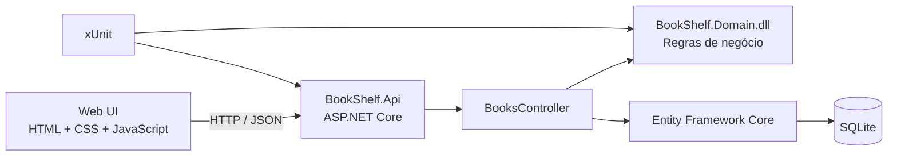
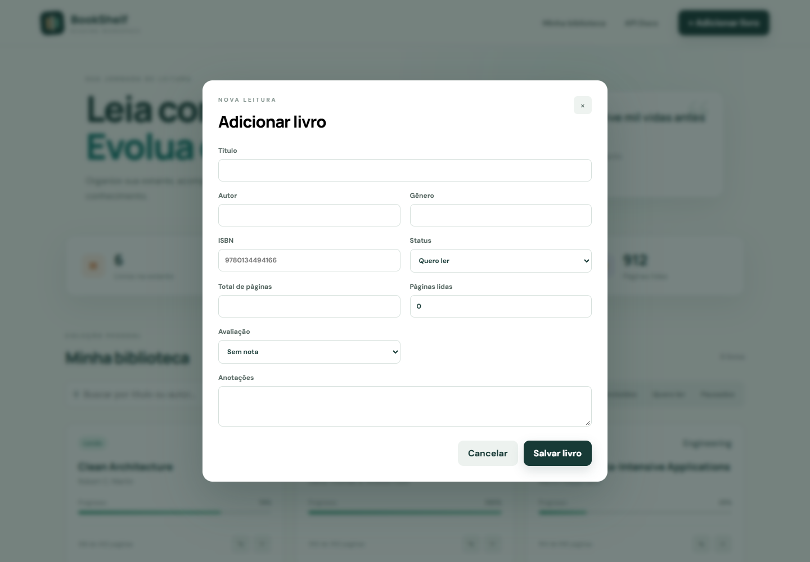

<div align="center">

# BookShelf

### Reading workspace com ASP.NET Core

Uma aplicação web completa para organizar livros, acompanhar o progresso de leitura e transformar dados da biblioteca em indicadores úteis.

[](https://dotnet.microsoft.com/)
[](https://learn.microsoft.com/aspnet/core/)
[](https://www.sqlite.org/)
[](https://github.com/matheuscorreiafranca/CBTSWE2_TP04/actions/workflows/ci.yml)

[Executar](#como-executar) · [Arquitetura](#arquitetura) · [API](#api-rest) · [Testes](#testes) · [Vídeo](#vídeo-demonstrativo)

</div>

---


## Sobre o projeto

O **BookShelf** resolve um problema simples e real: manter uma biblioteca pessoal organizada sem perder a visão do que está sendo lido, do que já foi concluído e de quanto falta para terminar cada livro.

O projeto foi desenvolvido para o Trabalho Prático 04 da disciplina CBTSWE2 e demonstra a integração entre uma Web API ASP.NET Core, uma DLL de regras de negócio, Entity Framework Core, SQLite e uma interface web responsiva. Todas as operações da tela consomem a API; não existem dados fixos nos componentes visuais.

## Funcionalidades

- cadastro, consulta, edição e exclusão de livros;
- busca por título ou autor e filtros por status;
- paginação e ordenação na API;
- indicadores de livros, leituras ativas, concluídos e páginas lidas;
- acompanhamento visual do progresso;
- projeção de páginas restantes, minutos e dias de leitura;
- validação dos dígitos verificadores de ISBN-10 e ISBN-13;
- validações de domínio, estados de loading, erro e lista vazia;
- persistência local com SQLite e migrations;
- documentação interativa com Swagger/OpenAPI;
- respostas de erro padronizadas com Problem Details;
- testes unitários e de integração da API;
- pipeline de integração contínua no GitHub Actions.

## Atendimento ao enunciado

| Requisito | Implementação |
| --- | --- |
| ASP.NET Core | Web API em .NET 8 com controllers |
| CRUD | Endpoints `GET`, `POST`, `PUT` e `DELETE` para livros |
| Banco local | SQLite criado automaticamente na primeira execução |
| ORM | Entity Framework Core com migration inicial e seed |
| Integração com DLL | `BookShelf.Domain.dll` concentra ISBN e projeções de leitura |
| Página web | SPA responsiva em HTML, CSS e JavaScript consumindo a API |
| Testes | xUnit para regras de domínio e fluxo HTTP completo |
| Documentação | README, Swagger, capturas e roteiro de vídeo |
| Boas práticas | DTOs, validação server-side, DI, async e tratamento de exceções |

## Arquitetura



```text
CBTSWE2_TP04/
├── src/
│   ├── BookShelf.Api/       # API, EF Core, migrations e aplicação web
│   └── BookShelf.Domain/    # DLL independente com entidade e regras
├── tests/BookShelf.Tests/ # testes unitários e de integração
├── docs/                 # imagens e roteiro da demonstração
└── BookShelf.sln
```

### DLL de domínio

`BookShelf.Domain` é compilado como uma biblioteca independente e referenciado pela API. Ele não depende de HTTP, banco de dados ou interface gráfica. A DLL fornece:

- entidade `Book` e enum `ReadingStatus`;
- validação matemática de ISBN-10 e ISBN-13;
- cálculo de percentual, páginas restantes e previsão de leitura;
- regras testáveis sem inicializar o servidor.

Essa separação evita duplicar regras e demonstra uma integração real com DLL, conforme solicitado no trabalho.

## Interface

### Biblioteca e indicadores


### Formulário de cadastro e edição



## API REST

| Método | Endpoint | Descrição |
| --- | --- | --- |
| `GET` | `/api/books` | Lista com busca, status e paginação |
| `GET` | `/api/books/{id}` | Consulta um livro |
| `GET` | `/api/books/summary` | Retorna indicadores da biblioteca |
| `POST` | `/api/books` | Cadastra um livro |
| `PUT` | `/api/books/{id}` | Atualiza um livro |
| `DELETE` | `/api/books/{id}` | Exclui um livro |

Parâmetros de listagem:

```http
GET /api/books?search=architecture&status=Reading&page=1&pageSize=12
```

Swagger: `http://localhost:5097/swagger`

## Como executar

### Pré-requisitos

- [.NET SDK 8](https://dotnet.microsoft.com/download/dotnet/8.0)
- Git

### Instalação

```bash
git clone https://github.com/matheuscorreiafranca/CBTSWE2_TP04.git
cd CBTSWE2_TP04
dotnet restore
dotnet run --project src/BookShelf.Api --urls http://localhost:5097
```

Acesse:

- aplicação: http://localhost:5097
- Swagger: http://localhost:5097/swagger

Na primeira inicialização a migration cria `bookshelf.db` e o seed inclui uma biblioteca de demonstração. O arquivo do banco é local e ignorado pelo Git.

### Migrations

```bash
dotnet tool restore
dotnet dotnet-ef database update --project src/BookShelf.Api
dotnet dotnet-ef migrations add NomeDaMigration --project src/BookShelf.Api
```

## Testes

```bash
dotnet build BookShelf.sln --configuration Release
dotnet test BookShelf.sln --configuration Release
```

A suíte cobre:

- cálculo de progresso e estimativas da DLL;
- ISBN válido, inválido e opcional;
- ciclo de criação, consulta, atualização e exclusão pela API;
- rejeição de progresso maior que o total de páginas.

O workflow [CI](./.github/workflows/ci.yml) restaura, compila com warnings como erros e executa a suíte a cada push ou pull request.

## Decisões técnicas

| Decisão | Motivo |
| --- | --- |
| SQLite | instalação zero e banco real em arquivo, adequado ao escopo acadêmico |
| Controllers | explicita os endpoints e facilita Swagger, validação e testes |
| DLL sem infraestrutura | mantém regras reutilizáveis e independentes do ASP.NET Core |
| SPA sem framework | reduz dependências e evidencia a integração HTTP diretamente |
| Problem Details | padroniza erros seguindo o formato da plataforma |
| Seed idempotente | garante uma demonstração consistente sem duplicar dados |

## Vídeo demonstrativo

O roteiro de gravação está em [docs/DEMO_SCRIPT.md](./docs/DEMO_SCRIPT.md). Antes da entrega acadêmica, publique o vídeo na plataforma indicada pelo professor e substitua esta frase pelo link final.

## Licença

Distribuído sob a [licença MIT](./LICENSE).
